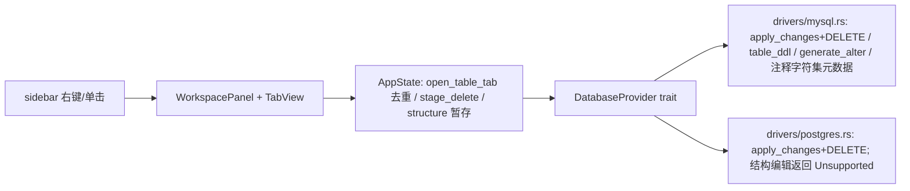

## Product Overview

在现有 thinsql 数据库桌面客户端上补齐三块表格使用体验：

## Core Features

1. **表数据 Tab 去重**：单击左侧连接树表节点打开表数据 tab 时，若该连接同库同名表的 tab 已存在，则不再新建，复用原 tab 并置为焦点；重复点击永远命中同一个 tab。
2. **数据行编辑增强**：

- 修改字段值（已有能力，保持暂存 → SQL 预览 → 单事务提交/回滚语义不变）；
- 新增**删除行**：在数据网格行上右键弹出"删除行"菜单，删除先进入暂存区，与字段修改合并到同一份待提交 SQL 预览（DELETE + UPDATE），统一提交（单事务，整体回滚）。

3. **表结构修改界面（先 MySQL）**：

- 表节点右键菜单新增"修改表结构"，打开结构编辑 tab（与数据 tab 一样按连接+表去重并聚焦）；
- 界面为顶部页签：**Columns（可编辑）**、**Indexes（可编辑）**、**Foreign Keys（只读）**、**DDL（只读）**；
- Columns 页签：列网格（序号、名称、类型、长度、可空、主键、默认值、注释、字符集），支持添加列、删除列、编辑列属性（名称/类型/长度/Nullable/主键/默认值/注释），参考截图交互；
- Indexes 页签：新建索引（选择列、唯一性）、删除已有索引；
- 所有结构变更先进暂存区，底部生成 ALTER TABLE SQL 预览，用户确认后统一执行；不提供 Triggers、Copy Fields from Another Table（后续版本）。

## Tech Stack

- Rust 1.99 / edition 2024；UI：gpui-kit 0.9.1（复用 DataTable、PopupMenu、Input、Button 等已有组件）；核心层 thinsql-core（驱动抽象 + MySQL 驱动 mysql crate/rustls）。

## Implementation Approach

### 1. Tab 去重（app 层，小改动）

- `AppState::open_table_tab`（state.rs:418-458）：分配新 id 前先在 `self.tabs` 里查找 `conn_id 相同 && tab.table == Some(同一 TableRef)`（比较 schema + name）的已有 tab，命中则直接返回该 id，由 `WorkspacePanel::ensure_view/focus_tab` 走既有聚焦路径。
- 结构修改 tab 同样以 `(conn_id, schema, table)` 为键去重：给 `QueryTab` 增加形态区分（现有 `table: Option<TableRef>` 基础上扩展 `structure: Option<TableRef>` 或引入 tab kind 字段），避免数据 tab 与结构 tab 互相误命中。

### 2. 删除行（core + app）

- `model.rs`：`RowChange`（model.rs:272-277）从单一 UPDATE 结构扩展为支持 `Update` / `Delete` 两种变更（enum 或加 kind 字段，保持序列化兼容）。
- `edit.rs`：新增 `build_delete`（与 `build_update` 同风格：主键等值定位、NULL 用 `IS NULL`、MySQL 加 `LIMIT 1`、标识符用方言引号）。
- `drivers/mysql.rs` / `postgres.rs` 的 `apply_changes`：按变更类型分支生成并执行，仍处同一事务内；主键缺失时维持现有 `ErrorKind::Unsupported` 行为。
- app 层 `results.rs`：订阅 DataTable 的行级右键事件弹出 PopupMenu（"删除行"），调用新增 `AppState::stage_delete`（校验只读/主键，加入暂存区）；`pending_sql`（state.rs:958-974）扩展渲染 DELETE 行；`commit_changes` 复用现有事务提交逻辑。

### 3. 表结构修改（先 MySQL）

- **core 元数据扩展**（全部落在 `drivers/` 下，遵守 AGENTS.md 的方言约束）：
- `provider.rs` trait 新增：`table_ddl(&mut self, table) -> Result<String>`（MySQL 用 `SHOW CREATE TABLE`）、`generate_alter(&mut self, table, ops) -> Result<Vec<String>>`（由驱动生成 ALTER TABLE 语句序列）、扩展 `ColumnMeta` 或新增 `ColumnDetail` 携带 `comment`/`charset`（MySQL 查 information_schema.COLUMNS）；
- PG 未实现的方法返回 `ErrorKind::Unsupported`，公共层零方言分支。
- 结构编辑操作模型（公共层定义、驱动翻译成 SQL）：`ColumnOp::Add/Alter/Drop`、`IndexOp::Create/Drop`，作用于 `TableRef`。
- **DDL 生成安全性**：列删除、主键变更等危险操作在预览 SQL 中原样展示，由用户确认后执行；标识符/字符串一律走驱动既有转义工具。
- **app 层新面板** `panels/structure.rs`：
- 顶部页签（gpui-kit 按钮组实现，参照现有 tabs 交互）：Columns / Indexes / Foreign Keys / DDL；
- Columns 用 DataTable + 编辑条（复用 results.rs 的双击编辑、Input 等既有模式；类型下拉先用 Input+PopupMenu 组合，因专用 Select 组件可用性未确认）；Null/PK 用勾选交互；
- 工具条：添加列、删除列；底部暂存条生成 ALTER SQL 预览 + 应用/放弃；
- `state.rs` 增加 `open_structure_tab`（含去重）与结构暂存状态；`workspace.rs` 的 `TabView` 增加结构视图分支；`sidebar.rs` 的 `build_context_menu`（L436-443）Table 分支追加"修改表结构"项。

## Architecture Design

延续现有分层：**UI(panels) → AppState(state.rs) → DatabaseProvider trait → drivers/mysql.rs**，方言知识仅存于驱动。



## Directory Structure

```
crates/thinsql-core/src/
├── model.rs                  # [MODIFY] RowChange 支持 Update/Delete；新增 ColumnDetail/ColumnOp/IndexOp/TableChange 结构
├── edit.rs                   # [MODIFY] 新增 build_delete； locate_key 复用
├── provider.rs               # [MODIFY] trait 新增 table_ddl / generate_alter（含默认 Unsupported 实现）
├── drivers/mysql.rs          # [MODIFY] apply_changes 处理 DELETE；SHOW CREATE TABLE；列注释/字符集元数据；ALTER 语句生成
├── drivers/postgres.rs       # [MODIFY] apply_changes 处理 DELETE
└── tests/                    # [MODIFY] build_delete、ALTER 生成的单元测试；MySQL 集成测试补删行/改结构用例
crates/thinsql-app/src/
├── state.rs                  # [MODIFY] open_table_tab 去重；open_structure_tab；stage_delete；结构暂存与应用
├── panels/sidebar.rs         # [MODIFY] Table 右键菜单追加"修改表结构"
├── panels/results.rs         # [MODIFY] 行右键删除菜单；待提交条展示 DELETE
├── panels/workspace.rs       # [MODIFY] TabView 支持结构视图，tab 去重后聚焦
└── panels/structure.rs       # [NEW] 表结构编辑面板：页签、列网格编辑、索引编辑、DDL/FK 只读、SQL 预览
```

## Implementation Notes

- 禁止在公共层出现 `if mysql`：ALTER/DDL 生成全部走 provider trait 方法。
- `ensure_view`/焦点管理沿用 workspace.rs 既有模式，TabView 新增字段需处理 tab 关闭时的资源释放。
- 暂存区语义保持"未提交不落库"，提交失败整体回滚（复用 apply_changes 事务）。
- 结构 tab 打开后异步加载元数据（columns/indexes/ddl），加载失败在面板内提示，不阻塞 tab 创建。

## Design Style

沿用项目现有 gpui-kit 主题（theme.rs 品牌色 #4c8dff、Dark/Light、圆角 6px），不引入新配色体系。

### 表结构修改界面布局（参照截图）

- 顶部工具条：页签按钮组（DDL | Columns | Indexes | Foreign Keys），右侧"查看数据"按钮跳回数据 tab、搜索列输入框、"添加列"主按钮。
- Columns 页签：DataTable 列网格，列为 序号 / 操作(上下移、复制、删除图标按钮) / Column / Type / Length / Nullable(勾选) / PrimaryKey(勾选) / Default / Comment / Charset；双击单元格进入行内编辑（复用 results.rs 编辑条模式），新增行置顶高亮。
- Indexes 页签：索引列表（名称、列组合、唯一性）+ "新建索引"按钮与删除操作。
- DDL / Foreign Keys 页签：只读等宽字体文本区 / 只读表格。
- 底部暂存条：ALTER TABLE SQL 预览（等宽字体）+ 应用 / 放弃按钮，与现有待提交条样式一致。

## Agent Extensions

### Skill

- **gpui-kit**
- Purpose: 结构编辑面板（页签、DataTable 行内编辑、PopupMenu、焦点管理）须遵循 gpui-kit 编码指南
- Expected outcome: panels/structure.rs 与 workspace 集成符合框架状态所有权与组件 API 规范
- **relational-database-design**
- Purpose: ColumnOp/IndexOp 模型设计与 MySQL ALTER TABLE 语句生成（列增删改、主键变更、索引增删）遵循数据库迁移 DDL 最佳实践
- Expected outcome: ALTER 生成安全、语句顺序正确（如先删索引再改列）、危险操作显式预览
- **test-driven-development**
- Purpose: edit.rs build_delete、驱动 ALTER 生成的单元测试先行
- Expected outcome: core 层 SQL 生成有单测覆盖，MySQL 集成测试含删行与改结构用例
- **rust-patterns**
- Purpose: RowChange enum 扩展与 trait 默认方法设计的惯用写法
- Expected outcome: 类型扩展向后兼容、错误处理一致

### MCP

- **codegraph**
- Purpose: 实施前快速定位 state.rs/results.rs/workspace.rs 相关符号与调用点
- Expected outcome: 精确修改、避免遗漏调用方