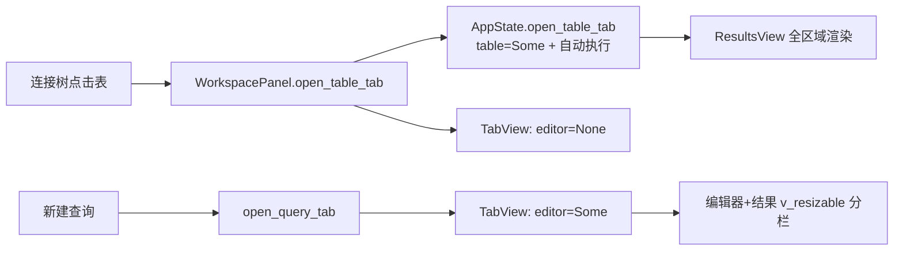

## Product Overview

调整 thinsql 桌面客户端工作区标签的布局行为，对齐主流数据库客户端的交互习惯：

## User Requirements

- 点击左侧连接树中的某个表时，打开的表数据标签应让**右侧整个区域以表格形式展示数据**（数据网格占满），不再显示 SQL 编辑器区域。
- 新建查询标签保持现状：上方为 SQL 编辑器区域，下方为结果数据区（可拖拽分栏）。
- 表数据标签仍需保留：连接/库名上下文信息、执行状态提示、加载更多、导出、单元格编辑与提交等已有能力（由 ResultsView 自带）。

## Core Features

- 表数据标签（`tab.table` 为 Some）：渲染为「上下文行 + 状态提示 + 全高度结果表格」，无编辑器、无执行/执行所有/取消按钮。
- 查询标签（`tab.table` 为 None）：维持现有 编辑器 + 结果 上下分栏布局，行为不变。
- 表数据标签切换绑定连接后，旧表上下文失效，应降级为普通查询标签（清空 `table` 字段）。

## Tech Stack

- Rust 1.99.1 / edition 2024，UI 使用 gpui-kit 0.9.1（沿用现有工程，无新增依赖）

## Implementation Approach

- 以 `QueryTab.table: Option<TableRef>` 作为两种标签形态的判据（已有字段，零迁移成本）：`Some` = 表数据标签，`None` = 查询标签。新增 `QueryTab::is_table_tab()` 助手方法，避免 UI 层散落 `table.is_some()` 判断。
- `workspace.rs` 的 `TabView.editor` 改为 `Option<Entity<EditorState>>`：表数据标签不创建编辑器实体（省内存、避免对不可见编辑器的焦点管理）；查询标签逻辑不变。Ctrl+Enter 订阅仅在编辑器存在时建立。
- `render_tab_body` 按形态分支：表数据标签渲染 `context_row`（内嵌 flex_1 的状态文本，替代被隐藏的 action_bar 状态位）+ 全高度 `ResultsView`；查询标签走原 `v_resizable` 分栏路径。
- `state.rs` 的 `set_tab_connection` 补清 `table` 字段（旧表数据与新连接不匹配，且 `pending_sql`/编辑提交依赖 table 上下文），并补单元测试。
- 性能与影响面：纯渲染分支调整，无数据结构变更、无额外遍历；`ResultsView` 复用现有实现，不动 `thinsql-core`。

## Key Code Structures

```rust
// state.rs
impl QueryTab {
    /// 表数据标签：整区显示数据网格；查询标签：编辑器+结果分栏
    pub fn is_table_tab(&self) -> bool { self.table.is_some() }
}

// workspace.rs
struct TabView {
    editor: Option<Entity<EditorState>>,   // 表数据标签为 None
    results: Entity<ResultsView>,
    _enter: Option<Subscription>,          // 仅查询标签存在
}
```

## Architecture Notes



## Agent Extensions

### Skill

- **gpui-kit**
- Purpose: 查询 gpui-kit 组件（resizable、DataTable、焦点管理）规范用法，确保 workspace.rs 布局分支改造符合框架约定
- Expected outcome: 布局分支与焦点处理遵循 gpui-kit Coding Guides，避免焦点/渲染陷阱
- **rust-testing**
- Purpose: 为 `set_tab_connection` 清空 `table` 字段补写符合项目既有风格的单元测试
- Expected outcome: state.rs 测试覆盖表标签切换连接降级场景，`cargo test -p thinsql-app` 通过