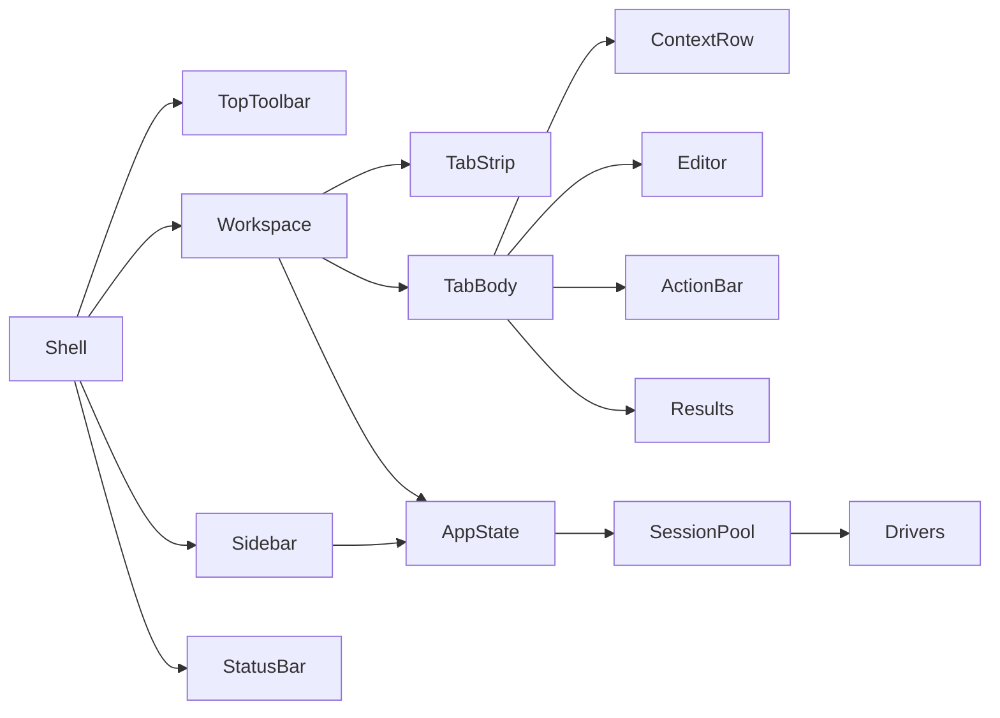

## 产品概述

把当前三栏式数据库客户端改造成参考图中的操作方式：顶部工具条、左侧单栏连接树、主区多标签工作台。每个标签拥有独立的连接上下文、SQL 编辑器与结果集；点击左侧表直接新开标签并显示数据；连接的新建与编辑改为工具栏弹窗和树上右键菜单。右侧 AI 助手面板不纳入本次。

## 核心功能

- 顶部工具条：新建连接、新建查询、刷新当前连接。
- 左侧单栏：搜索框；连接、库、表三层树，懒加载；连接节点右键支持连接/断开、新建查询、刷新、编辑、删除、只读切换；点击表打开新标签并自动执行预览 SQL；可在结构与历史之间切换。
- 标签工作台：可关闭标签、新建查询；每个标签独立保存编辑器文本、光标与撤销历史、连接与库上下文、结果集、执行状态和待提交改动；关闭标签时清理其进行中的请求。
- 标签工具条：执行（选中片段优先）、执行所有、取消、导出 CSV/JSON/INSERT、加载更多；结果区显示数据网格，多语句执行时显示序号、状态、返回行、影响行、耗时摘要。
- 连接弹窗：新建与编辑连接，支持 MySQL/PostgreSQL 切换与端口校验；编辑时密码留空表示不修改；删除需二次确认。
- 底部状态栏：当前连接、执行状态、结果行数与耗时。
- 保留现有能力：单元格编辑（主键定位、暂存/提交/回滚）、五万行分页上限、只读模式、钥匙串密码、查询历史。

## 视觉与交互

深色紧凑的 IDE 工作台：顶部约 40px 工具条，左侧约 280px 可拖拽栏，主区依次为标签条、连接与库上下文行、SQL 编辑器、操作条、结果区，底部 24px 状态栏。使用 1px 分隔线、轻微悬停反馈、无大卡片与多余留白；切换标签时编辑器焦点、光标与结果互不干扰。

## 技术栈

- Rust 2024，gpui-kit 0.9.1：复用 tree、input/editor、table、dialog、popup menu、resizable 组件。
- thinsql-core 现有 provider、session、sql 模块；复用 `sql::split_statements` 与 `model::table_preview_sql`。
- 不新增第三方依赖，不新增数据库专有分支。

## 实现策略

### 1. 布局：退出 Dock，改为显式工作台

`Shell` 不再创建 DockArea，改为四段自绘：

- 顶部 40px 工具条；
- 中部 `h_resizable` 左右分栏：`SidebarPanel`（初始 280px，范围 220 至 420）与 `WorkspacePanel`；
- 底部 24px 状态栏。

理由：Dock 的 panel 头与 tab 容器和「单栏树 + 每标签整块内容」冲突，标签正文需要整体替换，显式分栏层级更少、更贴近目标交互。

### 2. 状态层：从全局单结果改为多标签

`AppState` 删除 `result`、`result_rev`、`last_query`、`query_in_flight`、`current_pk`、`pending_changes`，新增 `tabs: Vec<QueryTab>`、`active_tab`、`next_tab_id`。
每个 `QueryTab` 保存：id、标题、连接 id、schema、表引用、初始 SQL（只消费一次）、结果（用 `Arc` 包装）、结果版本、最近请求、状态、语句执行摘要、待提交改动、主键列、等待连接后自动执行标记。
`current` 保留为「最近使用的连接」，只服务新建标签默认值，不再决定结果归属。

### 3. 事件路由：请求携带标签标识

- `ConnEntry.in_flight` 从「请求 id 到布尔值」改为「请求 id 到 InFlight」，记录标签、是否分页追加、语句序号。
- `Event::Result` 按请求 id 找到标签写回；非活动标签的结果也写回，不再丢弃。
- `Event::Applied` 与 `Event::Columns` 增加请求 id 回显，`Command::Apply` 与 `Command::ListColumns` 同步加字段，否则多标签下提交结果和主键会串到别的标签。
- 关闭标签时移除该标签全部进行中请求，迟到结果按未知请求 id 丢弃。

### 4. UI 与状态对账

`EditorState` 依赖 `window`，不能放进 `AppState`。`WorkspacePanel` 持有标签 id 到视图的映射，包含编辑器实体、该标签结果视图和 Ctrl+Enter 订阅。

- 状态层只负责标签增删、激活与查询生命周期。
- 面板在 render 时按 `tabs` 对账：新标签创建编辑器并消费初始 SQL；消失的标签释放编辑器、结果视图与订阅。
- 激活标签后把焦点交给对应编辑器；空工作区显示引导提示。

### 5. 点表即开标签

`AppState::open_table_tab(conn_id, table)` 创建标题为「表名@schema」的标签，写入 `table_preview_sql` 并立即查询；连接未建立时先发起连接并标记等待，`Event::Connected` 后自动执行。树点击与右键「打开数据」共用该路径，不依赖 UI 面板。

### 6. 执行语义

- 执行：选区优先，否则整段文本，保持 Ctrl+Enter 现状。
- 执行所有：用 `split_statements` 切分后顺序下发，每条记录序号、状态、返回行、影响行、耗时；遇错停止；超过 200 条截断并提示。
- 结果区：单条显示网格；多条显示摘要表加最后一条有结果集的网格。
- 取消、导出、加载更多都显式携带标签 id。
- 单连接会话串行执行，取消是连接级的，状态栏注明「取消作用于该连接当前语句」。

### 7. 连接管理

新增 `connection_dialog.rs`，提供 `open_connection_dialog(state, existing, window, cx)`：复用原表单字段与端口校验，新增编辑模式（密码留空不修改），保存时走新增或更新；删除用 `open_alert_dialog` 确认；移除右侧 Dock 与旧连接面板。

### 8. 左侧栏

`SidebarPanel` 包含搜索输入、树、结构与历史的分段切换。搜索用 `InputEvent::Change` 触发重建；树继续使用 `TreeState` 与占位节点懒加载；`build_items(conns, expanded, query)` 作为纯函数过滤连接名、库名、表名（大小写不敏感，命中自动展开祖先）。右键菜单用 `Tree::context_menu` 加 `PopupMenuItem`，按节点类型提供不同菜单项。

### 9. 视觉密度

沿用现有深色主题令牌，只调整密度：40、36、28 三档行高，1px 分隔线，选中使用 muted，悬停轻高亮，不引入新配色。

## 性能与可靠性

- 结果用 `Arc` 共享，避免现有结果面板在每次版本变化时整份克隆结果集（五万行时会明显卡帧）。
- 每标签结果独立，关闭即释放；树与结果只在状态事件或搜索词变化时重建，不在每帧重建。
- 执行所有采用串行，避免同一连接并发压垮会话线程；摘要条数封顶。
- 编辑器懒创建；订阅随标签释放，避免关闭后仍响应 Ctrl+Enter。
- 连接弹窗的构建函数可能重复执行，输入实体必须在打开弹窗前创建，这是 gpui 的明确要求。

## 架构设计



## 目录结构

```
crates/thinsql-app/src/
├── shell.rs                        # [MODIFY] 移除 DockArea，组装工具条、可拖拽左右分栏、底部状态栏；工具栏放置新建连接/新建查询/刷新
├── state.rs                        # [MODIFY] 多标签状态模型与事件路由；新增 open_table_tab、open_query_tab、activate_tab、close_tab、execute、execute_all、load_more、export、cancel、start_edit、stage_change、commit_changes、update_connection、refresh_schemas；改写旧单结果测试
├── panels/
│   ├── mod.rs                      # [MODIFY] 导出 workspace、sidebar、tree_model、connection_dialog；移除 dock 面板导出
│   ├── workspace.rs                # [NEW] 标签条、标签正文、连接与库上下文行、操作条、编辑器与结果视图的按标签对账及焦点管理
│   ├── sidebar.rs                  # [NEW] 搜索输入、树渲染、右键菜单、结构与历史切换、历史列表渲染
│   ├── tree_model.rs               # [NEW] 节点 id 编解码、build_items 与搜索过滤纯函数、占位节点，附单元测试
│   ├── editor.rs                   # [MODIFY] 由 Dock 面板改为每标签编辑器辅助：创建 EditorState、绑定 Ctrl+Enter、取选区或全文
│   ├── results.rs                  # [MODIFY] 由全局面板改为按标签结果视图：Arc 结果、网格、语句摘要表、单元格编辑条、待提交条、导出与加载更多
│   ├── connection_dialog.rs        # [NEW] 新建与编辑连接弹窗、端口校验、密码省略语义、保存后连接
│   ├── connections.rs              # [DELETE] 旧右侧连接面板，逻辑迁入弹窗
│   ├── history.rs                  # [DELETE] 逻辑并入 sidebar
│   └── schema_tree.rs              # [DELETE] 树构建迁入 tree_model 与 sidebar
crates/thinsql-core/src/
└── session.rs                      # [MODIFY] Command::Apply 与 Command::ListColumns 增加请求 id；Event::Applied 与 Event::Columns 回显；同步更新会话层测试
```

## 关键类型说明

- `TabId`：递增整数，进程内唯一。
- `QueryTab`：标签元数据与数据，不含任何 UI 实体。
- `InFlight`：标签 id、是否追加分页、语句序号。
- `StatementLog`：序号、状态、返回行、影响行、耗时，供执行摘要渲染。
- `TabView`：UI 层结构，持有编辑器实体、结果视图实体与订阅。

## 实施注意

- 结果交接使用 `Arc`，表格代理只保存 Arc 与版本号，避免复制行数据。
- 关闭标签不主动取消连接级查询，只清理本标签的进行中记录，防止误伤其他标签。
- 树搜索不修改持久化的展开集合，渲染时按命中结果临时展开。
- 连接弹窗不得记录密码日志；编辑时密码留空必须沿用钥匙串中的旧密码。
- 保持现有 provider 抽象，不在 UI 或状态层判断数据库类型，预览语句仍由 `table_preview_sql` 生成。

## 设计方向

沿用现有深色主题，改为参考图中的紧凑型 IDE 工作台。重点是信息密度与层级：工具条、侧栏、标签条、编辑器、操作条、结果区、状态栏各自用 1px 分隔线切分，不使用大圆角卡片和多余留白。整体对齐 DBeaver 一类数据库客户端的操作节奏。

## 布局与区块

- 顶部工具条：高 40px，左侧三个主操作（新建连接、新建查询、刷新），中间留白，右侧显示当前连接名。按钮使用次级样式，悬停时浅色底。
- 左侧栏：宽 280px，可拖拽至 220 至 420。顶部为搜索框与「结构 | 历史」分段切换；下方树每行 26px，连接节点加粗，库节点使用等宽小字，表节点悬停高亮、选中使用 muted 底。搜索命中时自动展开到表。
- 主工作区：顶部标签条高 36px，活动标签使用背景色与顶部 2px 主色指示条，非活动标签弱化，关闭按钮仅在悬停或活动时显现；标签过多时水平滚动。
- 标签正文：上下文行高 32px，包含连接下拉、库下拉、只读标识；其下为 SQL 编辑器（等宽 13px，行号弱化）；再下为操作条，执行按钮主色实心，其余为文本按钮；结果区占剩余高度，表头粘性，网格行高 28px。
- 底部状态栏：高 24px，左侧状态消息，右侧显示活动标签的连接、库、行数与耗时。

## 交互细节

- 点击表立即新开标签并进入执行中状态，标签标题显示「表名@schema」；切换标签恢复各自的编辑器内容、光标与结果。
- 右键连接节点弹出菜单，菜单项按连接状态启用或禁用；删除使用红色危险按钮确认。
- 空工作区显示一条居中的引导文案与「新建查询」按钮，不显示空白表格。
- 执行中标签标题旁显示小圆点，完成后消失；失败标签标题使用警示色。
- 动效克制：仅悬停底色、标签切换与结果加载使用 120 至 160ms 过渡，不做弹跳。

## 响应式

窗口最小 960×640：宽度低于 1100px 时侧栏收窄至 240px；结果区低于 180px 时自动压缩为摘要行加网格，编辑器保持至少 220px；窄窗口下工具条按钮保留图标与短文本。

## Agent Extensions

### Skill

- **gpui-kit**
- Purpose: 确认 gpui-kit 0.9.1 的实体、事件、组件与焦点用法，避免在布局、树右键菜单、弹窗和每标签编辑器上写出错误 API。
- Expected outcome: 所有新增面板均按框架既有模式实现，无编译期 API 误用，编辑器焦点与标签切换行为正确。
- **gpui-kit-design-guides**
- Purpose: 约束桌面应用的密度、层级、交互态与配色，保证改造后的工作台与参考图的操作节奏一致。
- Expected outcome: 工具条、侧栏、标签条、结果区与状态栏的间距、字号和交互态符合设计规范，并通过视觉核对。
- **rust-testing**
- Purpose: 指导多标签状态层与纯函数的单元测试改写，覆盖结果路由、标签关闭与多语句执行。
- Expected outcome: 状态层测试覆盖关键边界，旧测试全部迁移并通过。