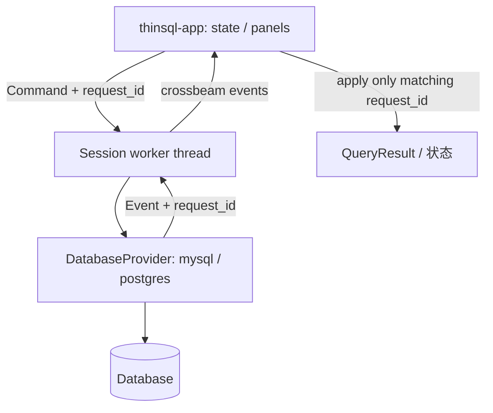

## User Requirements

- 对 thinsql 桌面客户端做一次**正确性与健壮性**专项审查，覆盖 `thinsql-core` 与 `thinsql-app` 两个 crate。
- 重点排查：静默吞错、会话状态泄漏、无界增长、错误处理缺陷、并发/生命周期导致的潜在 bug。
- 交付形式：先产出结构化审查报告（P0/P1/P2 分级，含 `文件:行号`、症状、根因、修复方向），再对 P0/P1 项给出具体代码改动方案，用户确认后执行。

## Product Overview

ThinSQL 是一款轻量级数据库桌面客户端：单进程、无 WebView/JVM，提供 MySQL/PostgreSQL 连接管理、库表结构浏览、SQL 编辑执行、结果网格、单元格编辑、查询历史与导出。本次不新增产品功能，只提升其在异常、并发与数据损坏场景下的正确性与健壮性。

## Core Features

- **审查报告**：按优先级记录问题、证据与修复建议，形成可追溯的审查文档。
- **P0 修复**：消除会静默产生错误结果或丢数据的问题，包括会话变量泄漏、配置/历史损坏覆盖、元数据丢行、查询结果串号、并发加载状态互相覆盖、结果集无上限增长。
- **P1 修复**：处理会话关闭阻塞、线程创建失败、TLS 模式被忽略、RETURNING 误判、输入校验、无效状态残留、吞错可观测性与 UI 线程同步 I/O。
- **回归保障**：为每个修复点补充单元测试，并在真实数据库集成测试与手动冒烟中验证。

## Tech Stack Selection

- 沿用现有技术栈，不引入 Web/前端方案：Rust edition 2024，`thinsql-core`（驱动抽象、值模型、配置、会话线程）+ `thinsql-app`（gpui-kit 0.9.1 UI）。
- 依赖现状：`crossbeam-channel`（unbounded 会话通道）、`mysql 28`（rustls）、`postgres 0.19`、`serde`/`serde_json`、`tracing`。
- 本次原则上**不新增依赖**：连接 ID 采用 `SystemTime` 纳秒 + 进程内 `AtomicU64` 计数器，避免引入 `uuid`；PostgreSQL TLS 是否接入 rustls 取决于实现期对同步连接器的可行性验证，未验证前走显式错误/告警策略。
- 保持约束：数据库专有知识（分页、元数据 SQL、类型映射、转义、方言）只出现在 `crates/thinsql-core/src/drivers/` 下。

## Implementation Approach

分两阶段推进：

1. **审查报告落盘**：把已核对的发现整理为 `docs/reviews/2026-11-18-correctness-audit.md`，按 P0/P1/P2 分级，每条包含证据（文件:行号）、症状、根因、修复方向与验证方式。
2. **分批修复 P0/P1**：按“状态泄漏与静默吞错 → 并发正确性 → 会话/安全 → UI 健壮性”的顺序落地，每批独立可测，避免一次性大改。

关键决策与理由：

- **MySQL 会话变量恢复**：`sql_select_limit` 是会话级状态，查询结束（含取消、错误、提前返回）必须恢复。采用“内层闭包/辅助函数 + 外层 finally 式恢复”保证所有返回路径都执行 `SET SESSION sql_select_limit = DEFAULT`，恢复失败记 `warn`。相比 RAII guard，避免与 `&mut Conn` 的借用冲突，改动更小。
- **配置/历史损坏可恢复**：在回退默认值之前，先把损坏文件重命名为 `*.corrupt-<unix_ms>` 备份，再返回默认值，并通过 `LoadOutcome { value, warning }` 把警告透传给 UI；保留原 `load_from` 签名，新增 `load_from_with_warning`，降低对现有测试与调用方的冲击。
- **驱动层错误保真**：PostgreSQL NUMERIC 解码失败不再 `unwrap_or_default()`，改为在 `convert` 中对 `Type::NUMERIC` 显式处理，失败返回可辨识文本（原始 hex）并 `warn`；元数据查询的 `filter_map(...ok()?)` 改为显式 `match`，单行失败 `warn` 并继续，全量失败返回 `Err`，避免“静默少表/少列”。
- **请求关联**：`Command::Query` 与 `Event::Result` 增加 `request_id: u64`，`Event::Failed`/`Event::Cancelled` 携带可选 `request_id`；`AppState` 为每条连接维护在途请求集合，只接受匹配的响应，过期事件丢弃。该改动解决取消/切换连接/多语句下的结果串号风险，是正确性核心。
- **并发加载隔离**：`pending_tables` 由单一 `Option<(conn_id, schema)>` 改为 `HashSet<(conn_id, schema)>`，两个连接或两个 schema 并发加载时互不覆盖。
- **结果无界增长**：在 `state.rs` 追加 `MAX_LOADED_ROWS`（建议 50_000）硬上限，达到上限后停止追加并提示，防止反复 Load more 导致 OOM。
- **会话生命周期**：`Session::drop` 先 `cancel.store(true)` 再发送 `Shutdown`，并把 `join` 放到后台线程或带超时回收，避免在途查询卡住 UI；`Session::spawn` 返回 `Result`，由 UI 显示线程创建失败，而非 panic。
- **UI 健壮性**：端口解析失败改为内联错误并阻止保存；连接 ID 用纳秒 + 原子计数防碰撞；`expanded` 在 schema/表刷新时清理失效节点；`disconnect` 与事件发送失败补 `warn`；config/history 保存与导出移入后台执行器，避免 UI 线程同步磁盘 I/O。

性能与可靠性：新增的 `request_id` 与 `HashSet` 均为常量级开销；`returns_rows` 改用 `prepare` 后 `columns().is_empty()` 判定，DML 多一次轻量 `prepare`，换取正确性；备份仅在检测到损坏时发生一次，不进入热路径。无明显吞吐或内存回退。

避免技术债：复用现有 `Error`、`tracing`、channel 与面板模式；所有驱动特化逻辑留在 `drivers/`；不改变对外产品行为，仅修正异常路径；测试与源码同文件内联，沿用项目现有 `#[cfg(test)]` 风格。

## Implementation Notes

- 兼容性：保留 `AppConfig::load_from`、`History::load_from` 现有签名；新增带 warning 的变体供 app 使用，避免破坏已有单测。
- 错误可观测：元数据失败采用“逐行 warn + 汇总 warn”，避免大量重复日志刷屏；日志不输出密码、密钥或完整结果集。
- 会话恢复：MySQL 恢复语句使用 `DEFAULT` 而非硬编码 501/最大值，语义更稳；若需保留用户自定义值，可在实现期改为先读取 `@@SESSION.sql_select_limit` 再恢复。
- TLS 风险控制：`SslMode::Required` 在未接入 TLS 前必须返回明确错误，禁止静默明文；`Prefer` 至少输出一次告警，并记录“已降级为 NoTls”。
- 测试策略：config/history 损坏备份、request_id 过滤、加载上限、端口校验用内联单元测试；`sql_select_limit` 恢复、元数据完整性、NUMERIC 异常用真实数据库集成测试补充。
- 回归边界：不重构结果网格渲染、不做无关性能优化（如三份结果拷贝、80ms 轮询改造），仅在报告中作为“相关建议”记录。

## Architecture Design

现有分层保持不变：



改动集中在四个边界：

- **drivers/**：修正会话变量、类型解码、元数据错误处理、TLS 模式与 RETURNING 判定。
- **session.rs**：扩展事件契约（request_id）、调整 spawn/drop 生命周期。
- **app/state.rs**：在途请求跟踪、并发加载隔离、结果上限、失效状态清理、启动警告透传。
- **persistence（config/history）**：损坏备份与带 warning 的加载结果。

不新增模块与架构模式，仅扩展既有接口；审查报告作为独立文档新增。

## Directory Structure

```
thinsql/
├── docs/
│   └── reviews/
│       └── 2026-11-18-correctness-audit.md   # [NEW] 结构化审查报告：P0/P1/P2 分级、文件:行号证据、症状、根因、修复方向与验证方式
├── crates/
│   ├── thinsql-core/
│   │   ├── src/
│   │   │   ├── drivers/
│   │   │   │   ├── mysql.rs                  # [MODIFY] 查询结束/取消/错误统一恢复 sql_select_limit；disconnect 吞错补 warn；复核 row.unwrap 语义
│   │   │   │   └── postgres.rs               # [MODIFY] NUMERIC 解码失败显式返回；元数据 filter_map 改显式错误处理；SslMode 显式处理；returns_rows 改用 prepare+columns；版本查询保留错误日志
│   │   │   ├── config.rs                     # [MODIFY] 损坏文件先备份 .corrupt-<ts> 再回退默认；新增 load_from_with_warning 返回 LoadOutcome
│   │   │   ├── history.rs                    # [MODIFY] 同 config：损坏备份 + 带 warning 加载
│   │   │   ├── session.rs                    # [MODIFY] Command/Event 增加 request_id；spawn 返回 Result；Drop 先取消再后台 join；事件发送失败 warn
│   │   │   └── error.rs                      # [MODIFY] 按需补充损坏/加载告警的错误种类或辅助构造函数
│   │   └── tests/
│   │       ├── mysql_integration.rs          # [MODIFY] 增加“分页查询后元数据不被 501 截断”的回归用例
│   │       └── postgres_integration.rs       # [MODIFY] 增加 NUMERIC 异常与元数据完整性的回归用例
│   └── thinsql-app/
│       └── src/
│           ├── state.rs                      # [MODIFY] 在途请求 request_id 跟踪；pending_tables 改 HashSet；加载更多行数上限；expanded 失效清理；启动警告展示；config/history/export 后台化
│           └── panels/
│               └── connections.rs            # [MODIFY] 端口范围校验并阻止保存；连接 ID 改为纳秒+原子计数
```

## Key Code Structures

```rust
// 请求关联契约：Command 与 Event 共享同一 RequestId
pub type RequestId = u64;

// Command::Query { sql: String, page: Page, request_id: RequestId }
// Event::Result { request_id: RequestId, result: Box&lt;QueryResult&gt; }
// Event::Failed { request_id: Option&lt;RequestId&gt;, error: Error }
// Event::Cancelled { request_id: Option&lt;RequestId&gt; }

// 配置/历史加载结果：显式携带警告，供 UI 展示
pub struct LoadOutcome&lt;T&gt; {
    pub value: T,
    pub warning: Option&lt;String&gt;,
}
```

## Agent Extensions

### SubAgent

- **code-explorer**
- Purpose: 在实施前对关键依赖语义与调用点做定向核实（如 `mysql::Row::unwrap` 版本行为、`postgres::Client::execute` 对 `Statement` 的支持、同步 rustls 连接器可行性、`schema_tree` 节点 id 格式）。
- Expected outcome: 在修改前拿到确认过的事实清单，避免基于错误假设改代码。

### Skill

- **test-driven-development**
- Purpose: 针对 P0/P1 修复先写失败用例再实现（config/history 损坏备份、request_id 过滤、加载上限、端口校验、sql_select_limit 恢复）。
- Expected outcome: 每个修复点均有先失败后通过的回归测试，防止后续回退。